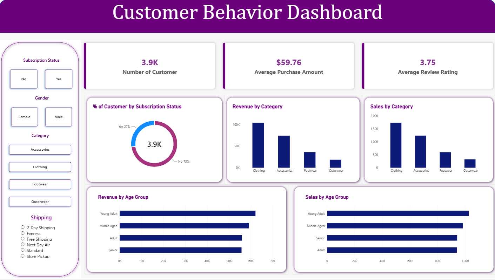

# 🛍️ Customer Shopping Behavior Analysis

> End-to-end analytics project: **Python → PostgreSQL → Power BI**

  

---

## 📖 Overview

This project analyzes **3,900 customer purchase transactions** to uncover insights about spending patterns, customer segments, product performance, and subscription behavior.

The goal: **turn raw data into business decisions** using a clean, end-to-end analytics pipeline.

---

## 🔄 Pipeline
